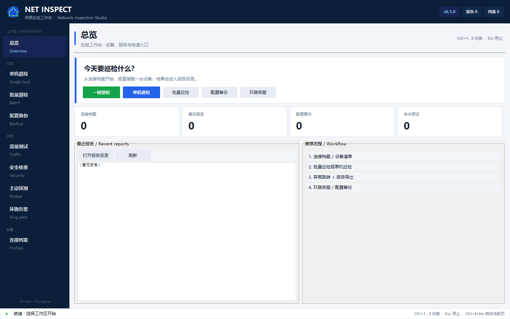
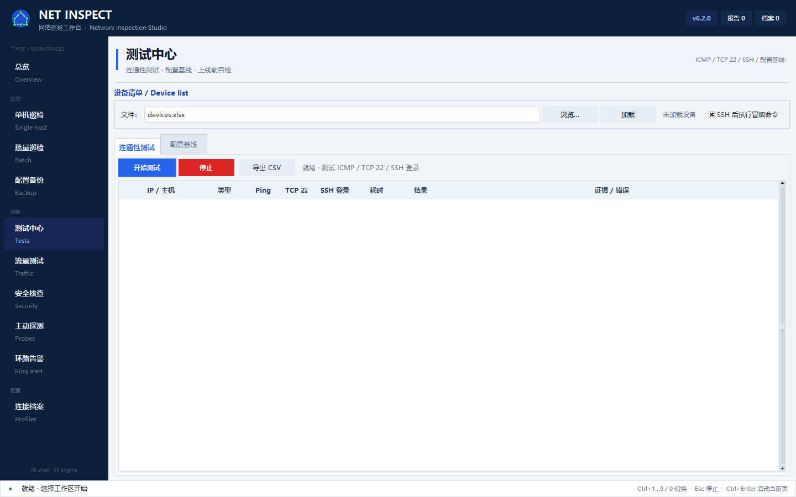
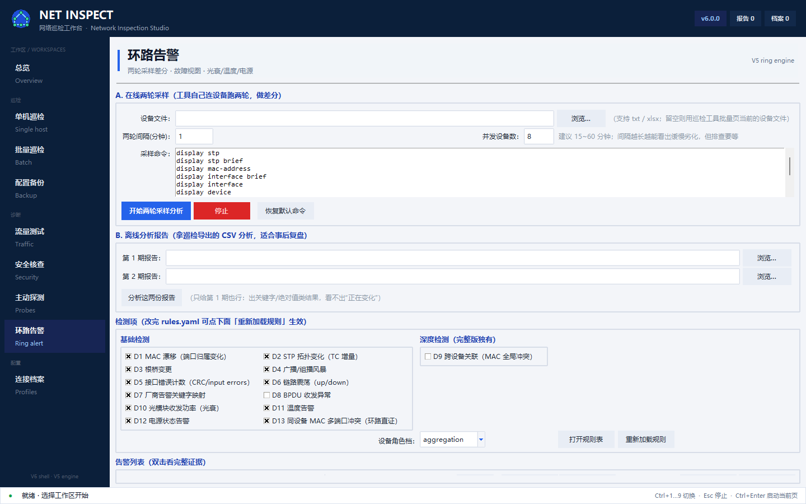

# Network Inspection Studio 6.1 使用指南

> 适用于 **v6.2.0**。界面为中文导航 + V5 巡检面板；示例使用文档地址
> `192.0.2.0/24`、`198.51.100.0/24` 和虚构 MAC。

> **隐私提醒：** 不要把真实设备清单、`profiles.json`、截图或导出报告提交到公开仓库。
> `devices.xlsx`、`profiles.json`、`reports/` 都应视为敏感文件。

---

## 1. 6.1 改了什么

- **凭据保险箱**：连接档案口令使用 Windows DPAPI 加密；旧明文自动迁移。
- **一键巡检**：总览页可加载设备清单并直接启动全量批量巡检。
- **报告中心**：双击最近报告打开，或一键打开报告目录。
- 深蓝顶栏 + 左侧工作区导航 + 页面标题条
- 按任务拆分工作区，不再是一排 8 个扁平页签
- 新增总览：连接档案、报告、备份、预设计数和快捷入口
- 常用控件中文翻译
- 独立启动器，V5 原界面保留为 legacy 回退

SSH、异常检测、报告、配置备份、流量、安全、探测、环路检测仍然复用 V5 引擎。

---

## 2. 安装与启动

### Windows exe

从 Releases 下载单文件 exe，双击运行，无需 Python。

### 源码

```bash
python -m pip install "paramiko>=3.5,<4" openpyxl pyyaml
python net_inspect_v6.py
```

可选安装：

```bash
python -m pip install -e ".[excel,yaml]"
net-inspect
```

旧界面：`python net_inspect_gui_v5.py` 或 `python net_inspect_gui.py`。

---

## 3. 工作区

| 工作区 | 用途 |
| :-- | :-- |
| 总览 Overview | 计数、一键巡检、报告中心 |
| 单机巡检 Single | 单台设备，命令集可编辑 |
| 批量巡检 Batch | 并行巡检、异常标红、CSV/HTML/Excel 导出 |
| 配置备份 Backup | 批量备份 `running-config` / `current-configuration` |
| 测试中心 Tests | ICMP + TCP 22 + SSH 登录 + 可选冒烟命令；配置基线差异 |
| 流量测试 Traffic | UDP / ICMP / TCP / TCP-SYN 与内置 TCP 接收端 |
| 安全核查 Security | 只读 DHCP snooping / DAI / DNS / 端口隔离 / 端口安全 |
| 主动探测 Probes | ICMP / DNS / DHCP / ARP / VLAN 探测 |
| 环路告警 Ring | 两轮采样差分、故障视图、光衰/温度/电源 |
| 连接档案 Profiles | 连接档案与命令预设 |

快捷键：`Ctrl+1…9 / 0` 切换工作区，`Esc` 停止，`Ctrl+Enter` 启动当前单机/批量/备份页。



---

## 4. 设备清单与连接档案

### 4.1 `devices.txt`

每行一台设备：

```text
# IP:用户名:密码:[类型]:"命令1,命令2,..."
192.0.2.10:demo:DEMO-PASSWORD:huawei:"display version,display cpu-usage"
192.0.2.11:demo:DEMO-PASSWORD:h3c:"display version,display cpu-usage"
```

类型：`linux`、`cisco`、`huawei`、`h3c`、`ruijie`（大小写不敏感），也支持中文别名。

### 4.2 `devices.xlsx`

推荐列：IP / 用户名 / 密码 / 类型 / 命令。需要 `openpyxl`；可安装 `excel` extra。

### 4.3 连接档案

**连接档案** 保存命名连接和命令预设。写入 `profiles.json` 前，口令会用 **Windows DPAPI（当前用户）**
加密；首次加载旧明文时会自动迁移。请把 `profiles.json` 当作敏感文件，不要提交到仓库。

---

## 5. 单机巡检

1. 选择设备类型（Linux / 华为 / H3C / 锐捷 / 思科）。
2. 填 IP、端口（通常 22）、用户名、密码。
3. 编辑命令集（每行 `标题::命令`）或加载预设。
4. 可勾选 **Ping 预检**，不可达设备直接跳过。
5. 点 **开始巡检**（`Ctrl+Enter`）。
6. 用 **异常检测** / **紧凑输出** 降低噪音；搜索高亮和“上一异常 / 下一异常”快速定位。

输出区保留 critical / warning / anomaly 颜色。

---

## 6. 批量巡检与报告

1. 加载 `devices.txt` 或 `devices.xlsx`。
2. 勾选目标设备（或全选）。
3. 设置并发、异常检测、紧凑输出、快速巡检。
4. 点 **开始巡检**；状态列实时显示 Running / OK / FAILED。
5. 导出 CSV、HTML 或 Excel。HTML 带异常摘要；报告写入 `reports/`。

对单台主机可用 **IP 情报** 快速查看情报摘要。

---

## 7. 配置备份

1. 加载设备清单。
2. 选择备份目录（默认 `backups/`）。
3. 勾选设备，点 **备份选中设备**。
4. 文件路径：`backups/<类型>/<IP>/<IP>_<时间戳>.cfg`。

备份在工作线程执行；**停止** 会发送共享停止事件。

---

## 7.5 测试中心



两种测试共用已加载的设备清单：

### 连通性测试

1. 加载 `devices.txt` / `devices.xlsx`。
2. 选择是否在 SSH 登录后执行冒烟命令（`display version` / `show version` / `uname -a`）。
3. 点 **开始测试**。
4. 表格显示 ICMP、TCP 22、SSH 登录、耗时和一行证据。
5. 结果可导出 CSV 到 `reports/`。

它刻意保持轻量：在完整巡检前先确认可达性和凭据。

### 配置基线

1. 加载设备清单，点 **检查配置变更**。
2. 读取当前配置，与 `baselines/<host>.cfg` 对比。
3. 结果：`新基线`、`一致`、`已变更`（含新增/删除行数）、`失败`。
4. 点 **保存为基线** 接受当前配置为新基线。

`baselines/` 已被 Git 忽略。它包含完整设备配置，请按敏感数据处理。

## 8. 流量测试

- 目标 IP / 端口 / 协议：UDP、ICMP、TCP、TCP-SYN。
- 可设置并发、包大小、速率。
- 内置 TCP 接收端可做端到端验证。
- 实时显示 PPS、Mbps、包数、字节数、耗时。
- 会产生真实流量，请在实验环境或维护窗口使用。

---

## 9. 安全核查

只读检查：

- DHCP snooping
- DAI / ARP 防护
- DNS 防重定向 / DHCP DNS
- 端口隔离 / 跨 VLAN ACL
- 端口安全 / MAC 学习限制

输入目标设备后运行。结果仅供参考；改生产配置前请核对厂商语法和业务意图。

---

## 10. 主动探测

适合新机器到现场、基础连通正常时使用：

- **DHCP 探测**：发现私接路由器 / 恶意 DHCP 抢答。
- **DNS 探测**：对比预期与实际解析，检查重定向。
- **ARP 探测**：发现 ARP 冲突 / 欺骗。
- **VLAN 探测**：测试跨 VLAN 连通性。

这些是诊断工具，不是攻击工具；只在你有授权的网络使用。

---

## 11. 环路告警

两种模式：

1. **在线两轮采样**：连接设备清单，采两轮做差分。
2. **离线报告分析**：比较两份导出的 CSV。

结果默认显示 **故障视图**：

- 每个疑似环路一张故障卡
- 置信度、涉及告警、受影响端口/VLAN/MAC
- 处置建议（“先拔这个口”）
- 右上角切到 **告警明细** 看原始证据

判据包括 MAC 漂移、STP 拓扑变化、根桥变化、广播风暴、CRC/input 错误、链路震荡、厂商环路日志、
BPDU 自环、光模块收光、温度、电源、跨设备 MAC 冲突。



---

## 12. 数据、报告与安全

| 路径 | 内容 |
| :-- | :-- |
| `backups/` | 设备配置备份 |
| `reports/` | CSV / HTML / Excel 报告 |
| `profiles.json` | 连接档案与预设（敏感） |
| `presets.json` | 命令预设 |
| `rules.yaml` | 环路规则 |

- 不要提交 `devices.xlsx`、`devices.txt`、`profiles.json`、`backups/`、`reports/`、`samples/`。
- 导出的 HTML/CSV 可能包含主机名、IP、日志和配置片段，按敏感数据处理。
- 生成结果和环路结论先在实验环境验证。

---

## 13. 常见问题

| 现象 | 排查 |
| :-- | :-- |
| SSH 认证失败 | 用户名/密码、设备 SSH 是否开启、ACL |
| `Unable to open channel` | 设备 VTY 会话占满；关闭其他会话后重试 |
| 老设备协商失败 | 使用内置的 Paramiko 3.5 兼容路径 |
| Excel 清单加载失败 | 安装 `openpyxl`；检查表头和 sheet |
| 没有报告文件 | 检查 `reports/` 写权限 |
| 环路页是空的 | 确认两轮都采到数据；查看采样体检提示 |
| 数据目录不对 | V6 用户数据在启动器旁；V5 legacy 用 `v5/` |
| 界面显示不全 | 最小 1180×740；环路/流量页建议最大化 |

## 14. 版本线

| 版本 | 入口 | 角色 |
| :-- | :-- | :-- |
| V6.2.0 | `net_inspect_v6.py` | Studio 外壳 + V5 引擎 |
| V5.2.2 | `v5/net_inspect_gui_v5.py` | V5 legacy 界面 |
| V3 | `net_inspect_gui.py` | V3 基础界面 |

详细变更见仓库 [CHANGELOG](../CHANGELOG.md)。
